# UNISFERA

**El ERP universitario donde ninguna regla se rompe:** matrícula, notas, pagos y becas de una universidad privada ecuatoriana en una sola esfera, con cada regla de negocio aplicada en la base de datos, el dominio y la interfaz.

[](https://github.com/DiegoFranciscoG/unisfera/actions/workflows/ci.yml)


[](LICENSE)

## Demo en vivo y usuario de prueba

La demo pública se habilita al desplegar (ver [Despliegue](#despliegue)). En local queda lista con un solo comando:

```bash
./scripts/generar-env.sh && docker compose up --build
```

- Aplicación: <http://localhost:8081> · API y Swagger: <http://localhost:8080/swagger-ui.html> · Correo de prueba: <http://localhost:8025>
- Usuarios demo: el registro del backend imprime una línea `Cuenta demo <ROL> → usuario <cédula>` por rol (estudiante, docente, secretaría, financiero, bienestar, académico y auditoría).
- Contraseña de todas las cuentas demo: el valor de `DEMO_PASSWORD` en tu `.env`.
- Todas las personas, cédulas y montos son **ficticios** y se generan con semilla fija (`20261013`).

## Capturas

| Ingreso con cédula en azulejos | Malla en órbitas | Matrícula en tres pasos |
|---|---|---|
| 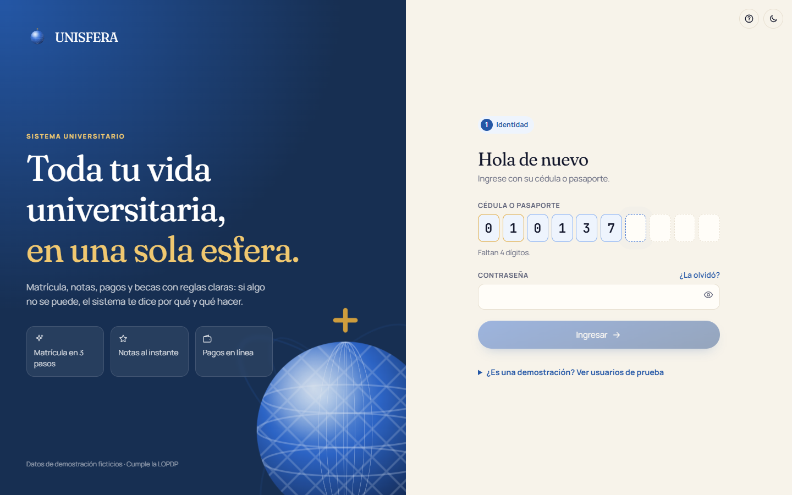 | 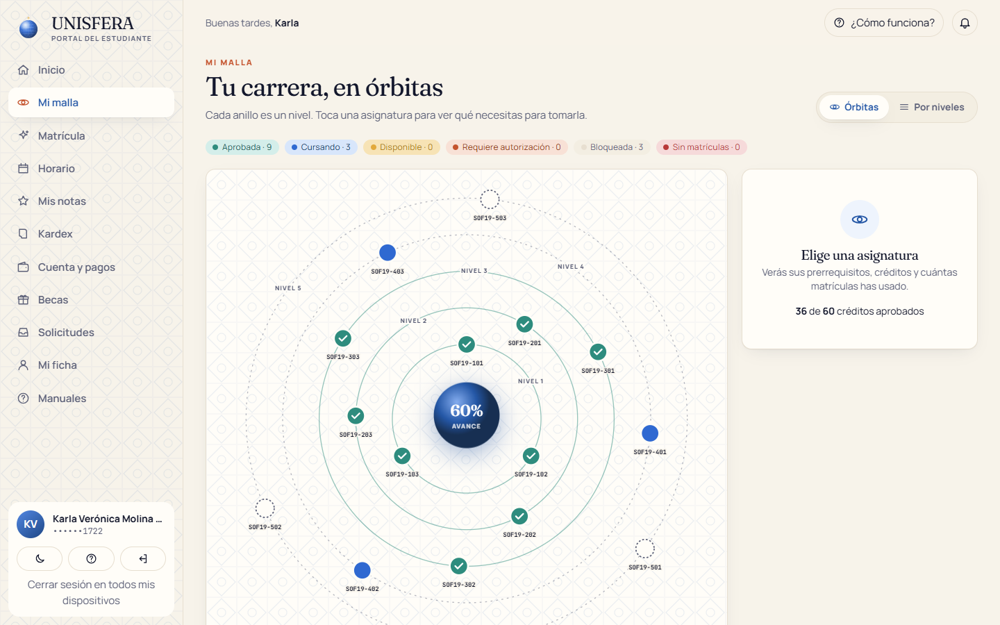 | 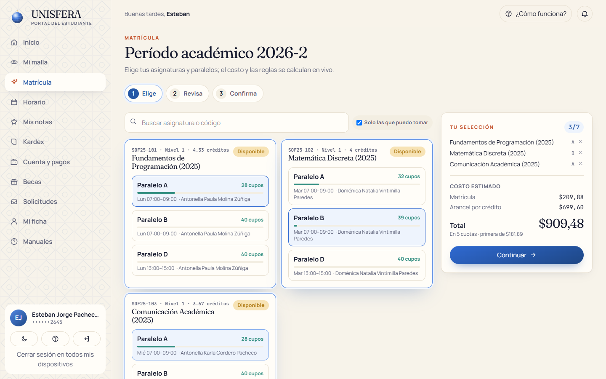 |

| Planilla docente | Tablero institucional | Parámetros versionados |
|---|---|---|
| 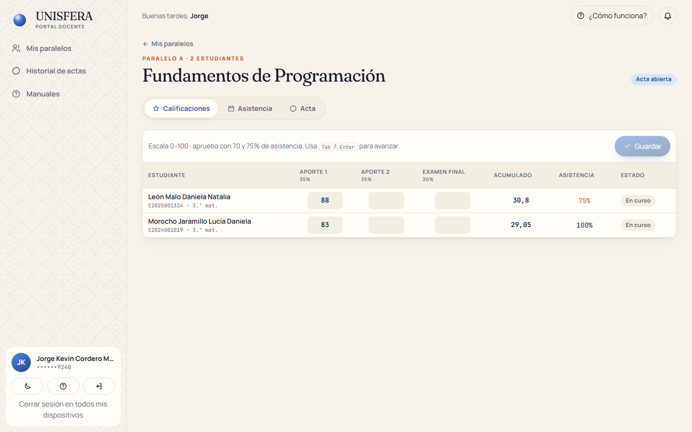 | 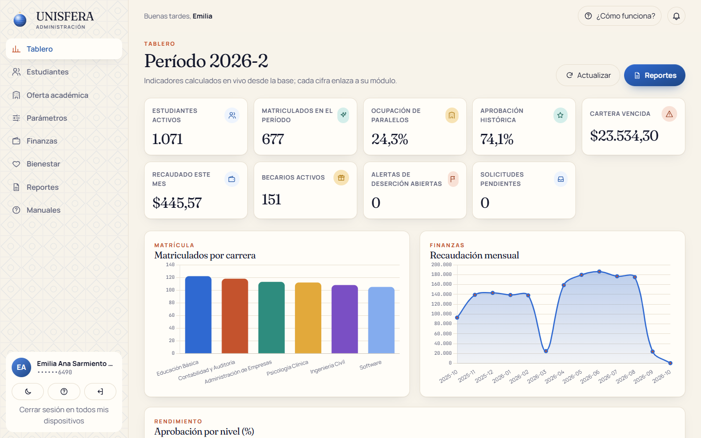 | 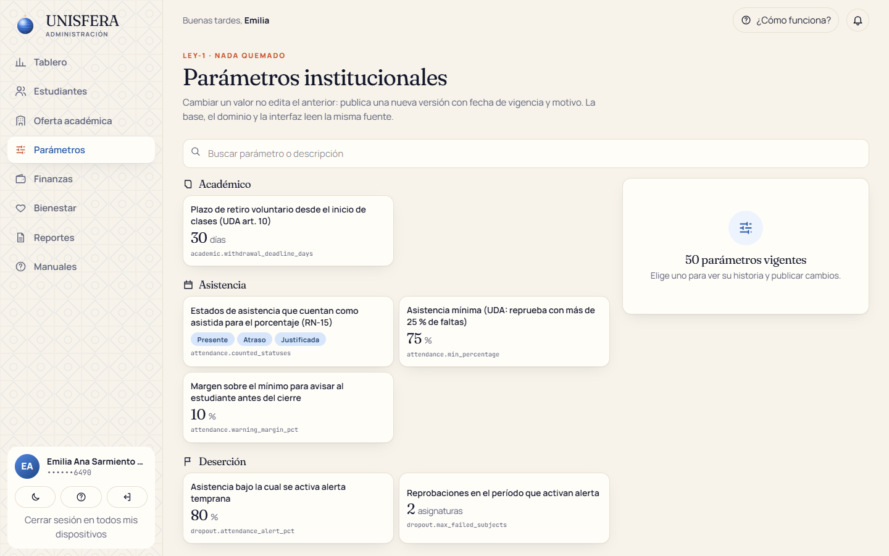 |

La misma aplicación se adapta a teléfonos, tabletas y escritorio, en modo claro u oscuro:

| Inicio en teléfono | Notas en teléfono | Menú en teléfono | Malla en modo oscuro |
|---|---|---|---|
| 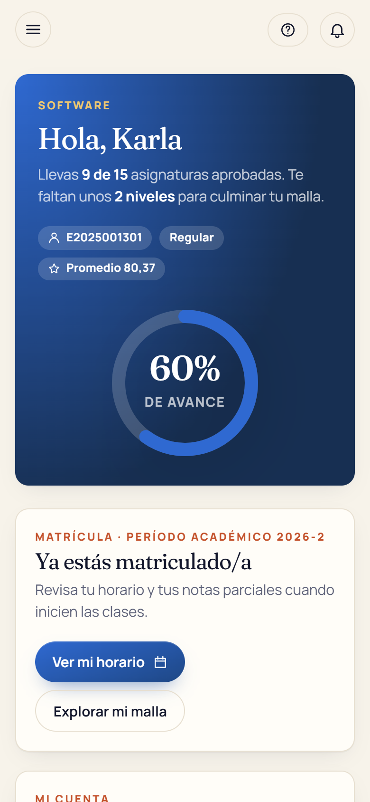 | 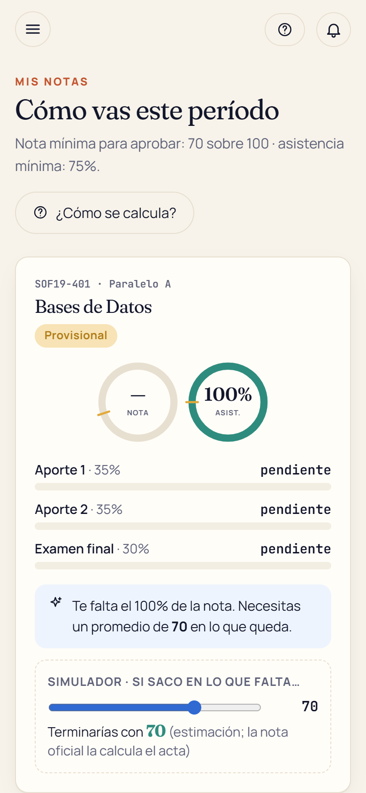 | 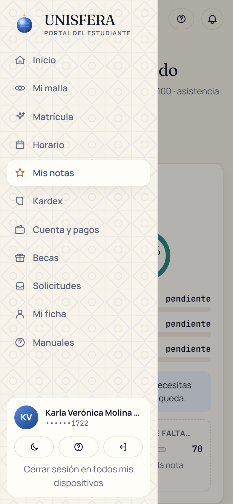 | 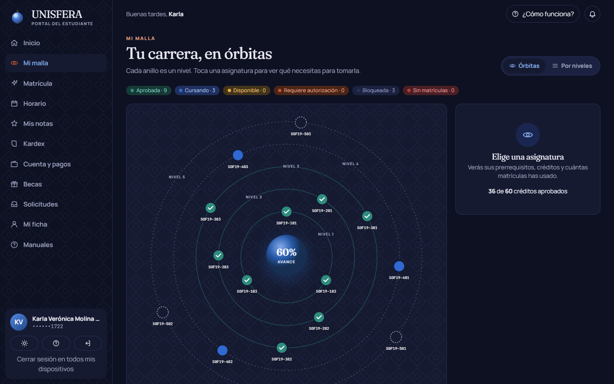 |

Las capturas se regeneran con `frontend/scripts/capturas.mjs` sobre el sistema en marcha.

## Problema que resuelve

En muchas universidades la matrícula, las notas y los cobros viven en sistemas distintos y las reglas académicas (tercera matrícula, prerrequisitos, cupos, asistencia mínima, becas) se aplican a mano o solo en la pantalla. El resultado: paralelos sobrevendidos el día de matrícula, notas modificadas después del cierre, pagos duplicados y becas aplicadas de forma retroactiva.

UNISFERA convierte el Reglamento de Régimen Académico (CES), la LOES, la LOPDP y la normativa tributaria del SRI en **reglas verificables**, guiadas por tres leyes:

| Ley | Qué significa | Cómo se garantiza |
|---|---|---|
| **LEY-1 · Nada quemado** | Ningún valor de negocio está escrito en el código | Tabla `parameter` versionada con vigencia y exclusión de solapamientos; un test recorre el código buscando literales de negocio |
| **LEY-2 · Nada se borra** | Se anula, se reversa o se rectifica; nunca se elimina | Triggers que rechazan `DELETE`/`TRUNCATE` en todas las tablas; auditoría de solo inserción particionada por año |
| **LEY-3 · La lógica no se rompe** | Cada regla en base, dominio e interfaz; manda la base | Triggers, `CHECK`, restricciones de exclusión GiST y transacciones; el error de la base llega al usuario con su código `RN-xx` y el manual que lo explica |

## Funcionalidades

**Estudiante**
- «Mi órbita»: avance de carrera, matrícula, saldo, clases de hoy y notas de un vistazo.
- Malla en órbitas: cada nivel es un anillo y cada asignatura un planeta con su estado y sus prerrequisitos.
- Matrícula en tres pasos con costo en vivo, cruces de horario detectados antes de confirmar y confeti al terminar.
- Notas con anillos, «lo que te falta» y simulador; kardex con promedio ponderado por horas.
- Estado de cuenta contable, pago en línea idempotente (pasarela simulada) y factura electrónica (RIDE).
- Becas con documentos, seguimiento y apelación; solicitudes con línea de tiempo; ficha con consentimientos LOPDP.

**Docente**
- Planilla de notas tipo hoja de cálculo con control de concurrencia optimista.
- Toma de asistencia en un toque y cierre ceremonial del acta con huella SHA-256 y firma.

**Administración**
- Tablero con indicadores en vivo, búsqueda de estudiantes con ficha 360°, oferta académica y mallas.
- Parámetros con línea de tiempo, finanzas (pagos presenciales, anulación con nota de crédito, mora, conciliación CSV).
- Bienestar: convocatorias, comité, alertas de deserción y atenciones cifradas con lectura auditada.
- Nueve reportes con supresión de celdas pequeñas y exportación Excel/PDF en segundo plano; bitácora de auditoría.

**Transversal:** funciona en Chrome, Edge, Firefox y Safari, en teléfono, tableta y escritorio; ayuda contextual en cada pantalla, 14 manuales descargables en PDF, tema claro/oscuro, accesibilidad (teclado, lectores de pantalla, `prefers-reduced-motion`).

## Arquitectura

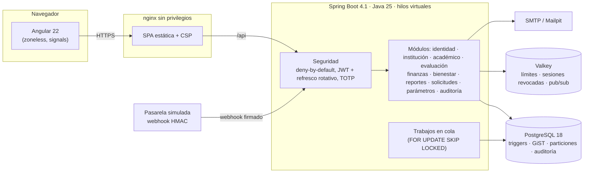

- **Monolito modular**: cada módulo tiene `api / application / domain / persistence`; ArchUnit impide dependencias indebidas (por ejemplo, el módulo académico no conoce a finanzas: se comunican por eventos de dominio y un puerto).
- **El dominio es Java puro** (sin Spring) y se prueba con propiedades sobre miles de casos generados.
- **La base es la última línea de defensa**: si alguien se salta el dominio, el trigger rechaza la operación con el mismo código de regla.

## Stack y por qué

| Pieza | Versión | Por qué |
|---|---|---|
| Java (Temurin) | 25 LTS | Hilos virtuales para el pico de matrícula sin reescribir a reactivo |
| Spring Boot | 4.1.1 | Seguridad, validación, Flyway, observabilidad y pruebas integradas |
| PostgreSQL | 18.6 | `uuidv7()`, restricciones de exclusión GiST, triggers diferidos y particiones |
| Valkey | 8.1.10 | Límite de intentos, sesiones revocadas e invalidación de caché; licencia BSD |
| Angular | 22.2 | Componentes standalone, signals sin Zone.js, View Transitions |
| Tailwind CSS | 4.3 | Sistema de diseño propio «Cúpula» con tokens y modo oscuro |
| Testcontainers | 2.0 | Pruebas de integración contra PostgreSQL y Valkey reales (nunca H2) |
| k6 · Playwright | 2.1 · 1.64 | Carga del día de matrícula y flujos críticos en el navegador |

El detalle de versiones verificadas está en [docs/dependencias.md](docs/dependencias.md).

## Modelo de datos

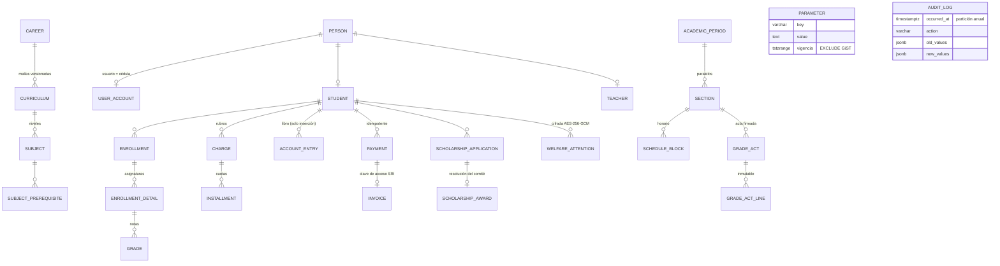

El modelo completo por módulo, con campos, restricciones y la regla que cada una aplica, está en [docs/modelo-datos.md](docs/modelo-datos.md). Las migraciones versionadas están en `backend/src/main/resources/db/migration` (Flyway, V1–V14).

## Cómo ejecutar en local

### Con Docker (recomendado)

```bash
./scripts/generar-env.sh
```

```bash
docker compose up --build
```

El script genera un `.env` con secretos aleatorios y una cédula ficticia válida para el superadministrador. El primer arranque crea el esquema y el escenario demo (unos minutos). Prueba de carga opcional:

```bash
docker compose --profile load run --rm k6
```

### Sin Docker

Requisitos: JDK 25+, Node 24.21+, PostgreSQL 18 y Valkey o Redis en marcha.

```bash
cd backend && ./mvnw spring-boot:run
```

```bash
cd frontend && npm ci && npm start
```

El backend lee las variables de entorno de la tabla siguiente; el frontend (puerto 4200) redirige `/api` al backend con `proxy.conf.json`.

## Variables de entorno

| Variable | Obligatoria | Descripción |
|---|---|---|
| `DB_URL`, `DB_USER`, `DB_PASSWORD` | Sí | Conexión a PostgreSQL |
| `REDIS_URL` | Sí | Valkey/Redis (`redis://:clave@host:6379`) |
| `JWT_SECRET` | Sí | Firma HS256 del token de acceso (≥ 32 bytes, Base64) |
| `SENSITIVE_DATA_KEY` | Sí | Clave AES-256-GCM de datos de bienestar (32 bytes, Base64) |
| `ACT_SIGNING_KEY` | Sí | Firma HMAC de las actas cerradas |
| `GATEWAY_WEBHOOK_SECRET` | Sí | Firma HMAC de los webhooks de la pasarela |
| `CORS_ALLOWED_ORIGINS` | Sí | Orígenes permitidos, separados por coma |
| `SUPERADMIN_ID_NUMBER`, `SUPERADMIN_INITIAL_PASSWORD` | Sí | Primer superadministrador (cambio de contraseña y TOTP obligatorios) |
| `SEED_DEMO_DATA`, `SEED_STUDENTS`, `SEED_LOAD_TEST_STUDENTS`, `DEMO_PASSWORD` | No | Escenario demo ficticio |
| `PUBLIC_BASE_URL`, `API_BASE_URL` | No | URL pública del frontend y URL interna del backend |
| `MAIL_HOST`, `MAIL_PORT`, `MAIL_FROM` | No | Correo saliente |
| `COOKIE_SECURE` | No | `true` en producción (HTTPS) |

Sin una variable obligatoria la aplicación **no arranca**: no existen valores por defecto para secretos. Plantilla: [.env.example](.env.example).

## API

Documentación interactiva en `/swagger-ui.html` (OpenAPI 3). Ejemplos ejecutables en [docs/api/unisfera.http](docs/api/unisfera.http).

| Método | Ruta | Uso |
|---|---|---|
| POST | `/api/auth/login` · `/api/auth/mfa/verify` · `/api/auth/refresh` | Ingreso con cédula, segundo factor y refresco rotativo |
| GET | `/api/me/curriculum` · `/api/me/enrollment/offer` | Malla con estados y oferta del período |
| POST | `/api/me/enrollment/preview` · `/api/me/enrollment` | Vista previa con costos y matrícula atómica |
| GET | `/api/me/grades` · `/api/me/kardex` | Notas provisionales y kardex oficial |
| POST | `/api/me/payments/intents` (cabecera `Idempotency-Key`) | Intento de pago idempotente |
| POST | `/api/public/gateway/{gateway}/webhook` | Notificación firmada de la pasarela |
| POST | `/api/teacher/sections/{id}/grades` · `/act/close` | Notas con versión y cierre firmado del acta |
| POST | `/api/parameters/{key}/versions` | Nueva versión de un parámetro |
| GET | `/api/reports/{code}` · POST `/api/reports/{code}/jobs` | Reporte en vivo y exportación en cola |
| GET | `/api/audit` | Bitácora de auditoría |

Los errores siguen RFC 9457 (`application/problem+json`) con `code` (`RN-05`, `SEC-03`…), `helpUrl` al manual y `requestId` para rastrear el caso.

## Tests y cobertura

| Tipo | Herramienta | Qué demuestra |
|---|---|---|
| Unitarios y de propiedades | JUnit 6 | Reglas del dominio sobre miles de casos generados con semilla fija |
| Integración | Testcontainers (PostgreSQL 18 + Valkey) | Cada regla también la rechaza la base; flujos completos por HTTP |
| Arquitectura | ArchUnit | Capas y módulos sin dependencias indebidas |
| Frontend | Vitest | Reglas espejo (cédula, contraseña, cruces) y renderizado seguro de manuales |
| End-to-end | Playwright | Ingreso, matrícula, pago y portal docente sobre el sistema completo, en Chromium, Firefox y Safari (WebKit), más Android e iPhone emulados |
| Adaptabilidad | Playwright (`scripts/auditar-responsive.mjs`) | Las 23 pantallas de los tres portales en 360, 768 y 1280 px: ningún elemento se sale del ancho visible |
| Carga | k6 | 2.000 matrículas en 10 minutos, p95 < 800 ms |

Pruebas obligatorias del proyecto:

| ID | Prueba | Dónde |
|---|---|---|
| T-01 | Ningún valor de negocio quemado en el código | `T01HardcodedValuesTest` |
| T-02 | 500 hilos compiten por 30 cupos, 20 repeticiones, nadie sobrevende | `SeatConcurrencyIT` |
| T-03 | Cinco notificaciones (dos simultáneas) generan un solo pago | `PaymentIdempotencyIT` |
| T-04 | 10.000 movimientos aleatorios: el estado de cuenta siempre cuadra | `LedgerPropertyTest` |
| T-05 | Ninguna combinación generada permite saltar un prerrequisito | `EnrollmentPolicyTest` |
| T-06 | Actas, notas históricas y pagos confirmados son inmutables | `ActFlowIT`, `ScholarshipAndPaymentRulesIT`, `T09MigrationsIT` |
| T-07 | Cada endpoint respeta el aislamiento por rol | `T07IsolationIT` |
| T-08 | Datos sensibles cifrados, lectura auditada, fuera de reportes | `T08SensitiveDataIT` |
| T-09 | Migraciones desde cero y escenario demo coherente | `T09MigrationsIT`, `DemoSeedIT` |
| T-10 | Los pesos deben sumar 100: falla en la base, no solo en la interfaz | `ActFlowIT.rn11AndRn12_*` |
| T-11 | Carga del día de matrícula | `load-tests/k6/matricula.js` |
| T-12 | Cero secretos y cero datos personales reales | gitleaks en CI + verificación previa a publicar |

Resultado de la prueba de carga (T-11) en un portátil con `docker compose`: 2.000 matrículas en 2 min 13 s con 250 usuarios concurrentes; p95 de 237 ms al matricular y de 78 ms en oferta y vista previa; 0 % de errores del servidor; 659 matrículas confirmadas y 1.340 rechazadas correctamente por falta de cupo (RN-05). Verificación posterior en la base: 0 paralelos sobrevendidos, 0 contadores descuadrados, 0 choques de horario y 0 estados de cuenta descuadrados.

Cobertura de líneas del backend: **88 %** (JaCoCo; umbral 85 % en dominio y 75 % en servicios de aplicación, y el build falla si baja). Ejecutar todo:

```bash
cd backend && ./mvnw verify
```

```bash
cd frontend && npm test
```

## Despliegue

Plan 100 % gratuito (límites verificados en 2026):

| Pieza | Servicio | Notas |
|---|---|---|
| Backend (Docker) | Render free | Se suspende tras 15 min sin tráfico; 750 h/mes por workspace |
| PostgreSQL 18 | Neon free | 0,5 GB y 100 CU-h por proyecto |
| Valkey | Render Key Value free | Solo límites y sesiones: no guarda datos de negocio |
| Frontend | Vercel o Netlify | Reescritura de `/api/*` al backend |

En producción: `COOKIE_SECURE=true`, `SEED_LOAD_TEST_STUDENTS=0`, `CORS_ALLOWED_ORIGINS` con el dominio real y secretos en el gestor del proveedor.

## Seguridad aplicada

- **Deny-by-default**: cada endpoint declara `@RequiresPermission`, `@AuthenticatedOnly` o `@PublicEndpoint`; un test recorre todos los endpoints con cada rol. Los permisos viven en la base.
- **Identidad**: usuario = cédula validada con módulo 10; Argon2id; bloqueo progresivo con IP registrada; mismo mensaje y tiempo ante usuario inexistente; TOTP (RFC 6238) obligatorio para roles administrativos.
- **Sesión**: token de acceso de vida corta solo en memoria; refresco en cookie `HttpOnly` + `SameSite=Strict` con rotación y detección de reutilización; cierre de sesión en todos los dispositivos.
- **Datos personales (LOPDP)**: atenciones de bienestar cifradas con AES-256-GCM, consentimiento explícito revocable, lectura auditada, supresión de celdas pequeñas en reportes, cédulas enmascaradas en pantalla y datos demo ficticios.
- **API**: Bean Validation en cada DTO, errores RFC 9457 sin trazas, límite de intentos en ingreso, subida de archivos validada por firma de bytes, tamaño y nombre, SQL siempre parametrizado, Actuator expone solo `health`.
- **Pagos**: clave de idempotencia, eventos únicos de la pasarela, bloqueo `FOR UPDATE` y webhooks con firma HMAC.
- **Infraestructura**: imágenes multi-etapa con versión fija y usuario no root, healthchecks, CSP y cabeceras de seguridad en nginx, acciones de GitHub fijadas por SHA con `permissions: contents: read`, gitleaks y Trivy en CI.

Política de reporte de vulnerabilidades: [SECURITY.md](SECURITY.md).

## Decisiones técnicas

- **Reglas en la base además del dominio.** El día de matrícula el cupo se reserva dentro del trigger con `UPDATE … WHERE enrolled_count < capacity`: la base serializa la carrera por el último cupo sin bloqueos explícitos en Java. Los cruces de horario se impiden con una restricción de exclusión GiST sobre rangos de minutos.
- **Compuerta de concurrencia.** Un semáforo justo limita las matrículas simultáneas por instancia para proteger el pool de conexiones; el resto espera en orden en lugar de fallar.
- **Parámetros versionados en vez de configuración.** Una regla de mora o una escala de notas cambia por resolución; versionarla con vigencia permite responder «qué valor se aplicó a esta cuota» años después.
- **Libro contable de solo inserción.** El saldo es una vista sobre movimientos; las correcciones son reversos. Una prueba de propiedades lo verifica con 10.000 movimientos aleatorios.
- **Monolito modular antes que microservicios.** Una sola transacción cubre matrícula y facturación; los módulos se comunican por eventos de dominio y puertos, listos para separarse si hiciera falta.
- **Interfaz que explica.** Cada error trae su código y un enlace al punto exacto del manual: el estudiante entiende qué pasó y qué hacer sin llamar a Secretaría.

La investigación normativa con fuentes y supuestos está en [docs/investigacion.md](docs/investigacion.md) y el catálogo completo de reglas en [docs/reglas-negocio.md](docs/reglas-negocio.md).

## Roadmap

- Integración real con una pasarela (Payphone, Datafast o Kushki) detrás del puerto `PaymentGateway`.
- Envío de comprobantes al SRI (recepción y autorización) con firma XAdES.
- Titulación y emisión de títulos con registro en SENESCYT.
- Aplicación móvil con notificaciones push.
- Analítica de deserción con modelos explicables.

## Fuentes de datos y licencias

- Normativa ecuatoriana consultada (CES, LOES, LOPDP, SRI, IESS, reglamentos públicos de universidades) con URL y fecha en [docs/investigacion.md](docs/investigacion.md). Los textos normativos son de dominio público; solo se citan.
- Todos los datos son **sintéticos**: nombres combinados al azar, cédulas generadas con dígito verificador válido y montos simulados. No contiene datos de personas reales.
- Tipografías: Fraunces, Manrope y JetBrains Mono (SIL Open Font License), servidas desde el propio sitio.
- Código bajo licencia [MIT](LICENSE).

## Autor

**Diego Francisco Granda Zhingre**

- GitHub: [@DiegoFranciscoG](https://github.com/DiegoFranciscoG)
- LinkedIn: [diego-francisco-g](https://www.linkedin.com/in/diego-francisco-g-61b793254)
