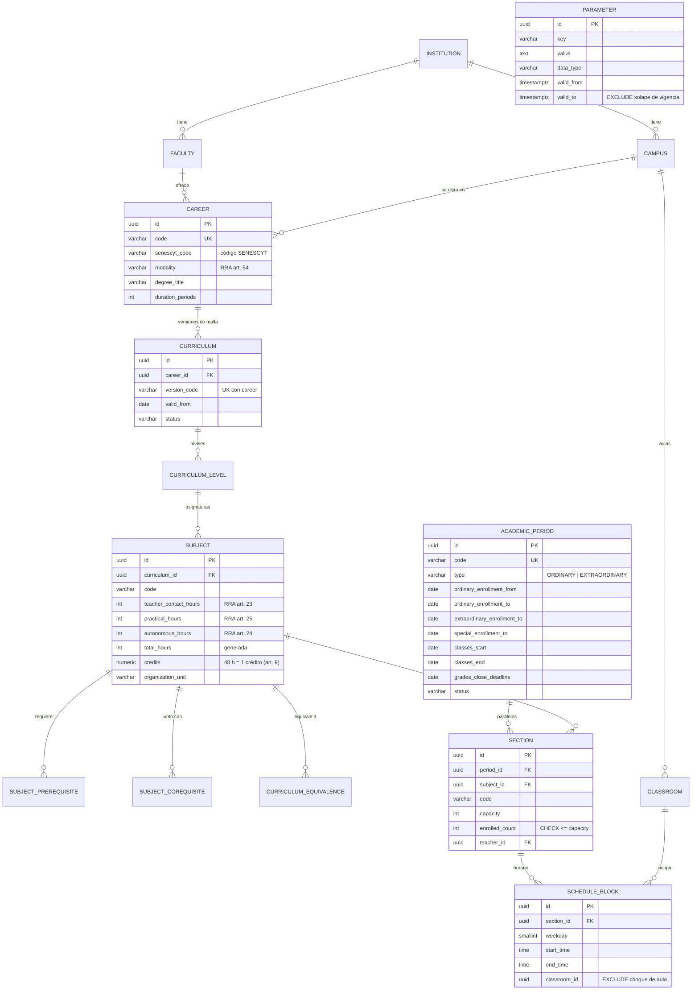
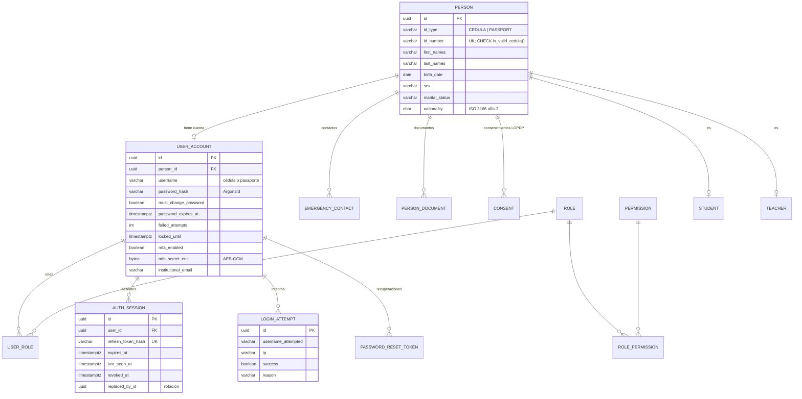
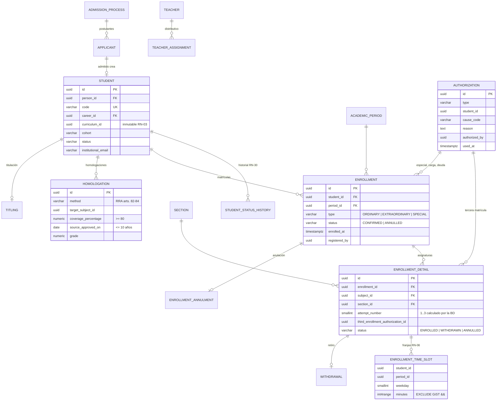
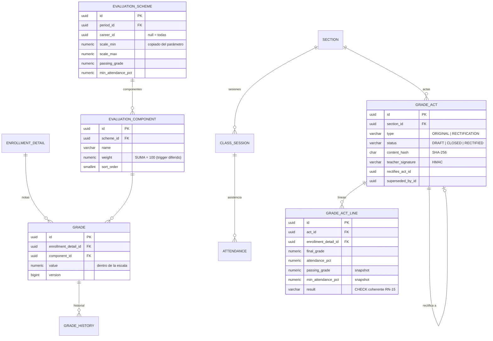
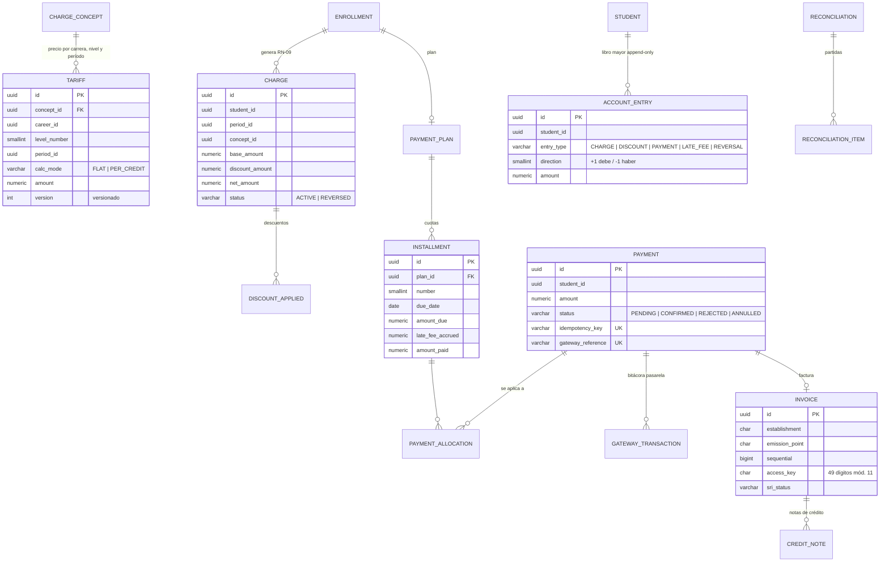
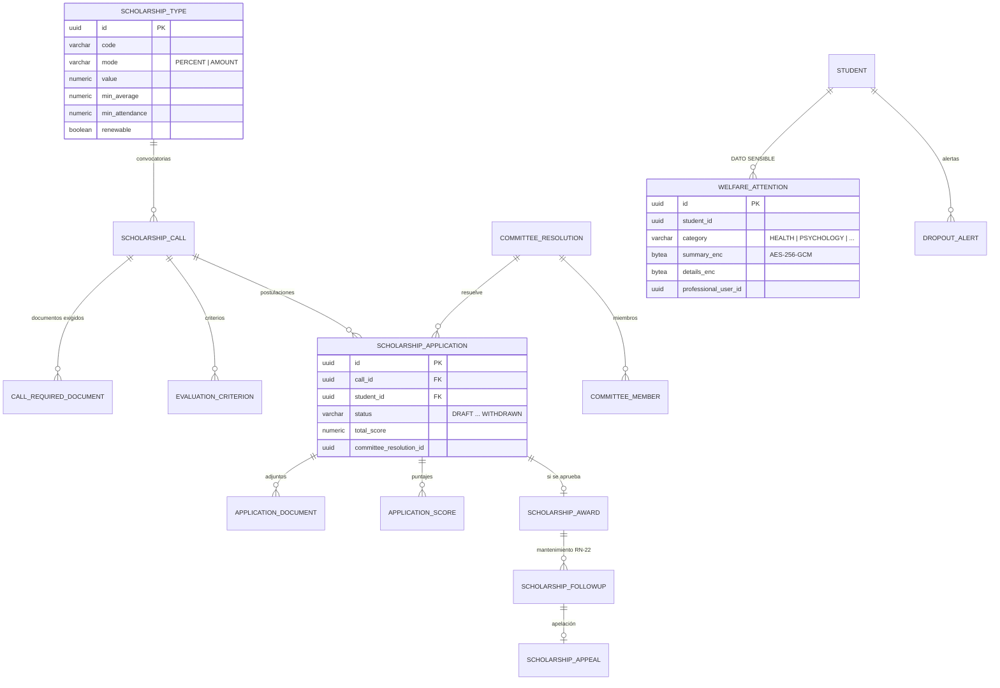

# Modelo de datos

PostgreSQL 18. Migraciones versionadas con Flyway en `backend/src/main/resources/db/migration`. Derivado de las fuentes de [`investigacion.md`](investigacion.md) (#n) y de las reglas de [`reglas-negocio.md`](reglas-negocio.md).

## Convenciones

- Identificadores `uuid` **v7** (ordenados por tiempo: buena localidad de índice y no enumerables). Se generan en Java (`UuidV7`) o con `uuidv7()` de PostgreSQL 18.
- Toda tabla de negocio lleva `created_at`, `created_by`, `updated_at`, `updated_by`, `version` (bloqueo optimista) y, donde aplica, `annulled_at`, `annulled_by`, `annulment_reason`.
- Fechas y horas en `timestamptz` (UTC); fechas de calendario (`date`) interpretadas en `America/Guayaquil`.
- Dinero en `numeric(12,2)`; porcentajes en `numeric(5,2)`; notas en `numeric(5,2)`. Nunca coma flotante.
- **LEY-2**: trigger `forbid_delete()` en DELETE y TRUNCATE de todas las tablas de negocio. **Auditoría**: trigger `audit_row_change()` escribe en `audit_log` solo las columnas que cambiaron, con actor, IP y request-id que la aplicación fija por transacción (`set_config('unisfera.actor_id', …, true)`). Las columnas sensibles (`*_enc`, `password_hash`, `*token_hash`) se enmascaran.
- Tablas grandes particionadas: `audit_log` por mes (RANGE) y `attendance` por período (LIST), con partición `DEFAULT` y función que crea particiones nuevas.

## Institucional y paramétrico

## Personas, identidad y seguridad

## Académico

## Evaluación

Vistas: **`v_kardex`** (líneas de actas `CLOSED` + homologaciones aprobadas, con horas y créditos) y **`v_student_average`** (promedio ponderado por horas, RN-16).

## Financiero

Vista **`v_account_statement`**: cargos − descuentos − pagos + mora = saldo (RN-29).

## Bienestar

## Transversal

| Tabla | Para qué | Restricción clave |
|---|---|---|
| `audit_log` | Quién, cuándo, IP, request-id, tabla, registro, valor anterior y nuevo | Particionada por mes; trigger bloquea UPDATE y DELETE |
| `notification` | Avisos en la app y por correo | `read_at` es lo único editable |
| `student_request` + `student_request_event` | Solicitudes (certificados, retiros, homologaciones) con flujo de aprobación | Eventos append-only |
| `stored_file` | Archivos con tipo, tamaño, hash y nombre saneado | Tipo validado por firma de bytes |
| `background_job` | Cola de reportes y cargas masivas | Consumo con `FOR UPDATE SKIP LOCKED` |
| `process_log` | Bitácora de cierres, cargas masivas y trabajos programados | Append-only |
| `consent` | Consentimientos LOPDP por finalidad | Revocación sin borrar |

## Catálogos oficiales usados

| Catálogo | Valores | Fuente |
|---|---|---|
| Modalidad | PRESENCIAL, SEMIPRESENCIAL, EN_LINEA, A_DISTANCIA, HIBRIDA, DUAL | RRA art. 54 (#1) |
| Tipo de matrícula | ORDINARY, EXTRAORDINARY, SPECIAL | RRA art. 71 (#1) |
| Componentes de aprendizaje | contacto con el docente, práctico-experimental, autónomo | RRA arts. 22–25 (#1) |
| Métodos de homologación | CONTENT_ANALYSIS, KNOWLEDGE_VALIDATION, PROFESSIONAL_PRACTICE, INTERNAL_RECOGNITION | RRA arts. 81–84 (#1) |
| Tipo de comprobante SRI | 01 factura, 04 nota de crédito | Ficha técnica off-line (#8) |
| Provincia de cédula | 01–24, 30 | (#9, #10) |
